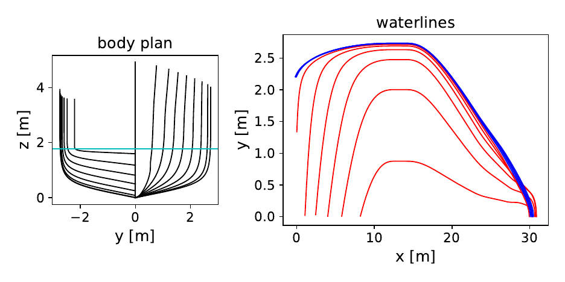

# parametric-yacht-hull

`gen_hull.py` generates the hull of a motor yacht (20–50 m) with a classical bulbous bow from 33
shape parameters and a fixed displaced volume. Every combination of parameters inside the documented bounds gives a valid,
fair hull.

The bow is parametrised with the bulb parameters of A. M. Kracht, *Design of Bulbous Bows*,
SNAME Transactions 86 (1978), pp. 197–217.



## What it produces

| File | Content |
|---|---|
| `hull_grid.p3d` | structured surface grid, PLOT3D ASCII (one block, starboard half; all coordinates on one line) |
| `hull_nurbs.dat` | degree and knot vectors of the B-spline whose control points are the PLOT3D points |
| `hull.step` | STEP AP214 closed solid (hull, deck and transom), or open shell on request |
| `hull_hydro.dat` | hydrostatics, form coefficients, Kracht's bulb parameters, stability and validity checks |

## Main parameters

| Group | Parameters |
|---|---|
| Main dimensions | length, displaced volume (fixed datum, matched exactly), relative beam (the draft follows from the volume), freeboards |
| Volume distribution | prismatic and midship coefficients, LCB (all matched exactly), forebody fullness, parallel middle body |
| Bow | waterline convexity, entrance angle, stem rake and curvature |
| Run | transom immersion (displacement to semi-displacement), breadth (down to an almost closed stern), section shape and rake; keel rise; bilge shape; flare and tumblehome; stern flare |
| Sections | blend of a deadrise-and-side family with a round family (U / wineglass), separately amidships and at the transom |
| Bulb | Kracht's breadth, length and height parameters, section type (Δ / O / ∇), fairing, nose-up bend, additive or implicit volume |

## Requirements

Python 3 with `numpy` and `scipy`. `matplotlib` is only needed for the optional 3D preview.

```bash
pip install -r requirements.txt
```

## Usage

```bash
python3 gen_hull.py                          # reads hull_params.dat, opens a 3D preview
python3 gen_hull.py --no-plot --ni 96 --nj 32
python3 gen_hull.py --params my_hull.dat --step my_hull.step --no-plot
python3 gen_hull.py --no-plot --no-step --no-nurbs   # only the grid and the hydrostatics (faster)
python3 gen_hull.py --help                   # all options
```

`hull_params.dat` is an example input for a 30 m yacht: one `value = name` line per parameter.
The meaning and bounds of every parameter, the conventions, the file formats and all output
quantities are described in the user manual: [`doc/gen_hull_user_manual.pdf`](doc/gen_hull_user_manual.pdf).

## License

MIT, see [LICENSE](LICENSE).
